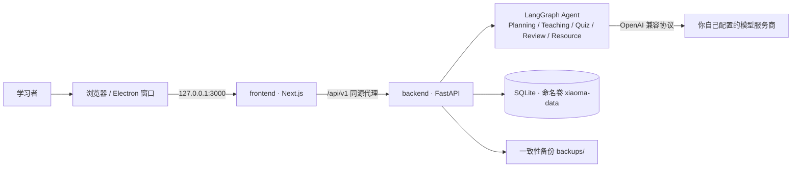

<div align="center">

# 小码 Xiaoma

**开源 · 免费 · 自托管的 AI 编程学习教练**

不只是「看教程」，而是用结构化课程 + 持续验证，陪零基础学习者真正把编程学会。

[](LICENSE)
[](https://github.com/clear-14/XiaoMa/releases)
[](https://www.python.org/)
[](https://nodejs.org/)
[](docker-compose.yml)
[](#贡献)

[中文](README.md) · [English](README.en.md) · [快速开始](#快速开始) · [自行打包](#自行生成安装包) · [文档](#文档) · [Issues](https://github.com/clear-14/XiaoMa/issues)

</div>

---

## 项目简介

小码把「课程、计划、练习、测验、错题、AI 讲解」串成一条完整的学习闭环：从能力诊断生成个人学习计划，每天下发任务，学完用测验验证掌握度，错题按 1/3/7/14 天安排复习，遇到不懂的知识点可以直接在对话工作台里让 AI 结合你当前的学习上下文讲解。

- **自带教材**：7 门课程、190 课时、1,253 道题的完整中文教材，首发课程为《Python 零基础入门》（20 章 / 29 课时，每课时 15 个固定内容模块）。
- **自带模型，不自带密钥**：支持 DeepSeek、通义千问、OpenAI 及任意 OpenAI 兼容端点，API Key 由使用者在设置页填写并加密存本地。
- **数据全在本地**：SQLite + Docker 命名卷，学习记录、会话与备份都留在自己机器上，不上传开发者服务器。
- **Agent 编排**：LangGraph 主 Agent + Planning / Teaching / Quiz / Review / Resource 五个子图，确定性意图识别，写操作一律经 Service 校验。

> [!IMPORTANT]
> 桌面窗口只是**加载器**，前后端服务都跑在 Docker 容器里，所以 Docker Desktop 必装；使用 AI 对话前还需要在「系统设置 → 模型配置」里添加自己的模型 API Key，否则教学类请求会返回 409 提示。

> [!NOTE]
> 仓库里**不含安装包**（`desktop/dist/` 是构建产物，已被忽略）。安装包从 [Releases](https://github.com/clear-14/XiaoMa/releases) 获取，或按 [自行生成安装包](#自行生成安装包) 从源码生成。

## 目录

- [核心特性](#核心特性)
- [技术栈与架构](#技术栈与架构)
- [快速开始](#快速开始)
- [自行生成安装包](#自行生成安装包)
- [配置](#配置)
- [安全与隐私](#安全与隐私)
- [测试](#测试)
- [项目结构](#项目结构)
- [文档](#文档)
- [开发状态](#开发状态)
- [贡献](#贡献)
- [许可证](#许可证)

## 核心特性

| 模块 | 能力 |
| --- | --- |
| 课程体系 | 5 个方向 / 7 门课 / 190 课时，课程 → 章节 → 课时 → 知识点 → 正文 / 练习 / 测验题，含先修依赖图与版本快照 |
| 学习计划 | 六维能力诊断 → 排期 → 草稿确认 → 版本化调整，历史可回溯；自述完成不会伪装成「已掌握」 |
| 每日任务 | 按计划与掌握度生成，支持自主选题、跨天承接、「我会了，测一测」诊断跳级 |
| AI 教学 | SSE 流式对话、会话持久化、L0/L1/L2 难度适配；模型失败时保存明确的失败消息，不伪造回复 |
| 测验与复习 | 7 种题型、知识点 / 章节 / 阶段组卷、自动评分、错题本与间隔复习；AI 变式题需双重验证才入库 |
| 掌握度 | 知识点级 7 态掌握度 + 只追加的证据流水，学习完成度与已验证掌握度分两轴显示 |
| 桌面窗口 | Electron 窗口壳：启动探活复用、自动拉起 Compose 服务、状态页错误码、窗口状态记忆 |
| 数据安全 | 可选访问密码（后端中间件强制校验）、API Key Fernet 加密、SQLite 在线备份与恢复 |

## 技术栈与架构

| 层次 | 选型 |
| --- | --- |
| 前端 | Next.js 16（App Router）+ React 19 + TypeScript |
| 后端 | Python 3.14 + FastAPI + Pydantic + SQLAlchemy + Alembic |
| AI | LangGraph（主 Agent + 5 个子图）+ 统一 OpenAI 兼容 Provider |
| 数据库 | SQLite（Docker 命名卷 `xiaoma-data` 持久化） |
| 桌面端 | Electron 45 + electron-builder 26 |
| 部署 | Docker Compose（默认仅绑定 `127.0.0.1`） |



完整的 API 交互文档由 FastAPI 自动生成，启动后端后访问 <http://127.0.0.1:8000/docs>；接口清单也可在下方[折叠区](#附录)查看。

## 快速开始

三种用法按场景选一条即可：

| 方式 | 适合谁 | 前置条件 | 入口 |
| --- | --- | --- | --- |
| **A. Docker Compose** | 想在浏览器里用、要部署到 NAS / 服务器 | Docker Engine 24+、Compose v2.24+ | 见下文 |
| **B. Windows 安装包** | 只想双击图标用，不碰命令行 | Windows 10/11 64 位 + Docker Desktop | 见下文 |
| **C. 源码开发** | 改界面、改后端、补教材 | Python 3.14、Node.js 22+ | 见下文 |

### 方式 A · Docker Compose（推荐）

```bash
git clone https://github.com/clear-14/XiaoMa.git
cd XiaoMa
cp .env.example .env
docker compose up -d --build
```

浏览器打开 <http://127.0.0.1:3000>。容器首启会自动执行数据库迁移并写入全部教材种子数据（幂等），首次构建需要几分钟。

默认**仅本机可访问**：前端绑定 `127.0.0.1`，后端不映射宿主机端口，由 Next.js 同源代理访问。开放局域网需同时设置 `BIND_ADDRESS=0.0.0.0`、`XIAOMA_ALLOW_REMOTE=true` 与强密码 `XIAOMA_ACCESS_PASSWORD`；公网部署必须加 HTTPS 反向代理，详见 [Docker 部署指南](docs/Docker部署指南.md)。

### 方式 B · Windows 桌面安装包

1. 安装并启动 **Docker Desktop**（勾选 WSL 2，装完重启，等左下角 `Engine running`）。
2. 从 [Releases](https://github.com/clear-14/XiaoMa/releases) 下载 `Xiaoma-Setup-1.4.1.exe`（约 120 MB），双击安装。安装包未做代码签名，SmartScreen 提示时选「更多信息 → 仍要运行」。
3. 双击桌面图标：首次启动会构建两个镜像，约 **60–90 秒**（本机实测 87 秒）；之后每次启动约 2 秒，因为窗口会先探活复用已运行的服务。
4. 左侧 → 系统设置 → 模型配置 → 添加模型（如 DeepSeek / `deepseek-chat`）→ 设为默认，再进「AI 学习工作台」发一句「你好」验证。

> [!TIP]
> 关窗口 ≠ 关服务，容器会继续后台运行；彻底停止用 `docker compose stop`。卸载程序不会删除学习数据，重装可续用。零基础分步说明见 [零基础桌面应用部署教程](docs/零基础桌面应用部署教程.md)。

### 方式 C · 源码本地开发

```bash
# 后端（http://127.0.0.1:8000，接口文档 /docs）
cd backend
python -m venv .venv
.venv/Scripts/pip install -r requirements.txt        # macOS/Linux 用 .venv/bin/
.venv/Scripts/python -m app.cli init-db             # Alembic 迁移
.venv/Scripts/python -m app.cli seed-courses         # 课程目录（幂等）
.venv/Scripts/python -m app.cli seed-questions      # 内置题库（幂等）
.venv/Scripts/python -m app.cli seed-textbook       # 零基础入门教材（幂等）
.venv/Scripts/python -m uvicorn app.main:app --host 127.0.0.1 --port 8000

# 前端（http://localhost:3000）
cd frontend
npm install
npm run dev

# 桌面窗口（需先让上面的服务跑起来）
cd desktop
npm install
npm run dev
```

其余教材种子命令（`seed-phase4a` ~ `seed-phase4e`）与环境变量说明见 [.env.example](.env.example) 和 [docs/开发进度与验收记录.md](docs/开发进度与验收记录.md)。

## 自行生成安装包

仓库不包含 exe。任何时候都可以从源码重新打出可分发的 Windows 安装包。

### 1. 前置条件

| 项目 | 要求 | 说明 |
| --- | --- | --- |
| Node.js | 22 或更高（`desktop/package.json` 的 `engines`） | 打包本身不需要 Docker；**运行**安装包才需要 Docker Desktop |
| npm | 随 Node.js 安装 | 用于安装 Electron 与 electron-builder |
| 操作系统 | Windows（打 `nsis` 安装包） | 首次打包需联网下载 Electron 二进制 |
| 工作目录 | 必须是仓库的 `desktop/` 目录 | 打包钩子会从上一级读取 `docker-compose.yml` |

### 2. 克隆、自检、打包

```bash
git clone https://github.com/clear-14/XiaoMa.git
cd XiaoMa/desktop

npm install                  # 安装 electron / electron-builder
npm run check                # 对 7 个主进程脚本做语法检查
npm test                     # 服务控制器 / preload 防护 / 无 shell 调用 三组单测
npm run dist:win             # 耗时约 3–6 分钟
```

产物：`desktop/dist/Xiaoma-Setup-1.4.1.exe`。文件名由 `desktop/package.json` 的 `version` 与 `artifactName: Xiaoma-Setup-${version}.${ext}` 共同决定，改版本号即改产物名。

### 3. 打包时实际装进了什么

`npm run dist:win` 会先执行 [`desktop/scripts/stage-project.js`](desktop/scripts/stage-project.js) 的 `beforePack` 钩子，按白名单把 Compose 工程复制到 `desktop/build-staging/project`，再放入安装包的 `resources/project`：

| 打进安装包 | 明确排除 |
| --- | --- |
| `docker-compose.yml`、`.env.example` | `.env`、`.secret_key`（密码与加密密钥） |
| `backend/`、`frontend/` 源码与 Dockerfile | `data/`、`*.db`（用户数据） |
| `frontend/public/`（空目录也保留，镜像构建需要） | `.venv/`、`node_modules/`、`.next/`、`dist/`、`.git/`、`tests/`、`*.log` |

> [!WARNING]
> 不要手动把本机的 `xiaoma.db` 或 `.secret_key` 塞进安装包：密钥与路径都绑定原机，换台机器起不来，还会泄露隐私。

macOS / Linux 打包脚本也已提供（`npm run dist:mac` / `npm run dist:linux`），但本项目只在 Windows 上完成过打包与安装实测。

### 4. 常见失败

| 现象 | 处理 |
| --- | --- |
| `打包缺少必要文件：docker-compose.yml` | 必须在 `desktop/` 目录执行，别在仓库根目录或子目录 |
| `批量删除被安全策略拦截` 警告 | 钩子会自动把旧暂存目录重命名归档并继续，不影响产物；可手动清理 `build-staging/project-stale-*` |
| 杀毒软件报毒 / SmartScreen 拦截 | 未签名的 Electron 应用常见误报，加白名单或自行购买代码签名证书 |
| 双击后停在「正在连接本地服务…」 | Docker Desktop 没启动，或首次构建未完成；排查见[教程第 6 节](docs/零基础桌面应用部署教程.md) |

### 5. 分发给别人

- **网页**：仓库 → Releases → Create a new release → 标签 `v1.4.1` → 上传 exe → Publish（单个资产上限 2 GB）。
- **命令行**：`gh release create v1.4.1 desktop/dist/Xiaoma-Setup-1.4.1.exe --title "小码 Xiaoma 1.4.1" --notes "Windows 安装包"`。
- **直接发送**：网盘 / U 盘传 exe 亦可，无需 Release。

静默安装 `Xiaoma-Setup-1.4.1.exe /S`；静默卸载建议用 PowerShell 的 `Start-Process ... -ArgumentList "/S" -Wait`（Git Bash 下可能出现「退出码 0 但文件没删」的假成功）。

## 配置

复制 `.env.example` 为 `.env` 后按需修改；本地开发使用代码默认值即可，`.env` 不会进入版本库。

| 变量 | 默认值 | 说明 |
| --- | --- | --- |
| `BIND_ADDRESS` | `127.0.0.1` | 宿主机端口绑定；`0.0.0.0` 表示开放局域网 / 公网 |
| `FRONTEND_PORT` | `3000` | 宿主机前端端口 |
| `XIAOMA_ACCESS_PASSWORD` | 空 | 设置后所有 API（健康检查 / 登录除外）强制登录 |
| `XIAOMA_ALLOW_REMOTE` | `false` | 远程访问显式开关，为 true 时必须有密码 |
| `XIAOMA_ACCESS_TOKEN_TTL_SECONDS` | `86400` | 会话有效期（秒） |
| `XIAOMA_SECRET_KEY` | 自动生成 | 模型 API Key 的 Fernet 加密密钥；更换后已存 Key 无法解密 |
| `XIAOMA_AGENT_TIMEOUT_SECONDS` | `120` | 主 Agent 整体超时（秒） |
| `XIAOMA_BACKUP_DIR` | 数据库同目录 `backups/` | 备份目录 |
| `CORS_ALLOW_ORIGINS` | 空 | 浏览器直连后端时的跨域白名单 |

## 安全与隐私

- 默认仅本机访问；远程绑定但未设密码或未显式允许时，后端**拒绝启动**。
- 访问密码由后端中间件校验 Bearer 令牌，不依赖前端隐藏页面；密码不入库、不返回前端、不写日志。
- 模型 API Key 用 Fernet 加密后存 SQLite，接口与页面只显示 `sk-****abcd`，日志不记录完整 Key。
- 使用 AI 教学时，教学提示词与必要学习上下文只发送给**你自己配置的模型服务商**，不会发给本项目开发者。
- **不执行用户提交的 Python 代码**，代码题只做文本分析与关键词评分（V1.0 起的设计约束）。
- 备份使用 SQLite 在线备份 API，运行中生成一致性快照；恢复前自动再备份一次并校验完整性。

## 测试

```bash
cd backend  && .venv/Scripts/python -m pytest tests/ -q     # 最近基线：545 passed
cd frontend && npm run lint && npx tsc --noEmit && npm test  # 最近基线：133 passed
cd desktop  && npm run check && npm test                    # 最近基线：18 passed
```

改动数据库模型后需生成 Alembic 迁移并确认 `alembic check` 零漂移。各阶段验收结果见 [最终开发报告与独立验收](docs/最终开发报告与独立验收.md) 与 [CHANGELOG](CHANGELOG.md)。

## 项目结构

```
XiaoMa/
├── frontend/            # Next.js 前端（App Router / Vitest）
├── backend/             # FastAPI 后端
│   ├── app/             # api / core / services / agent / repositories / seed
│   ├── alembic/         # 数据库迁移
│   └── tests/           # pytest 测试
├── desktop/             # Electron 窗口壳
│   ├── src/             # 主进程、preload、服务控制器、状态页
│   ├── scripts/         # stage-project.js 打包钩子
│   └── tests/           # node:test 测试
├── docs/                # 设计、教程、验收与课程教材说明（27 份）
├── docker-compose.yml   # 容器编排（默认仅本机访问）
├── .env.example         # 环境变量模板
├── CHANGELOG.md
└── LICENSE             # Apache License 2.0
```

## 文档

**上手与部署**

- [零基础桌面应用部署教程](docs/零基础桌面应用部署教程.md) — 装 Docker → 装小码 → 排障，含源码运行与自行打包三条路线
- [Docker 部署指南](docs/Docker部署指南.md) — 端口、局域网、HTTPS 反向代理、备份恢复
- [V1.0 部署操作方案](docs/V1.0部署操作方案.md) · [模型配置说明](docs/模型配置说明.md) · [常见问题](docs/常见问题.md)

**设计与验收**

- [V1.4 技术设计与契约](docs/V1.4技术设计与契约.md) · [V1.4 产品需求](docs/小码_Xiaoma_软件端_对话工作台版.md)
- [最终开发报告与独立验收](docs/最终开发报告与独立验收.md) · [开发进度与验收记录](docs/开发进度与验收记录.md)
- [项目总开发指令](docs/项目总开发指令.md) · [依赖版本记录](docs/依赖版本记录.md)

**课程与教材**

- [阶段 2 课程目录与学习路线](docs/课程扩展阶段2_课程目录与学习路线.md) · [阶段 3 零基础入门教材](docs/课程扩展阶段3_零基础入门教材.md)
- [阶段 5 掌握度与学习诊断](docs/课程扩展阶段5_知识点掌握度与学习诊断.md) · [阶段 6 学习闭环与 Agent 集成](docs/课程扩展阶段6_学习闭环与Agent集成.md) · [阶段 7 自主选题与学习完成度](docs/课程扩展阶段7_自主选题与学习完成度.md)

完整文档列表见 [`docs/`](docs/)，版本变更见 [CHANGELOG.md](CHANGELOG.md)，英文说明见 [README.en.md](README.en.md)。

## 开发状态

当前发布版本 **v1.4.1**（2026-11-09），包含阶段 0–11 与 V1.4 桌面端对话工作台。`Unreleased` 中的阶段 7（自主选题、学习完成度两轴分离、第 7 门课教材补齐）已合入主干，版本号待下次发布统一更新，详见 [CHANGELOG](CHANGELOG.md)。

<details>
<summary><strong>阶段与验收记录（点击展开）</strong></summary>

| 阶段 | 内容 | 状态 |
| --- | --- | --- |
| 0–2 | 环境、工程初始化、SQLite + SQLAlchemy + Alembic 基础架构 | 完成 |
| 3–4 | 前端 9 页面与设计系统、课程体系与《Python 零基础入门》种子课程 | 完成 |
| 5–6 | 学习计划（诊断 → 排期 → 草稿确认 → 版本化调整）、每日任务 | 完成 |
| 7–8 | 统一 LLM Provider 与密钥加密、AI 教学子图、会话与聊天历史 | 完成，DeepSeek 真实验收 |
| 9–10 | 测验评分与错题间隔复习、LangGraph 主 Agent + 5 子图 | 完成，7 个验收场景实测 |
| 11 | 测试、安全与部署：后端测试、Vitest、Compose 实跑、备份恢复 | 完成 |
| V1.4 | Electron 窗口壳、三栏工作台、9 类消息卡片、安装包实测 | 完成 |
| 阶段 4A–4E | 7 门课程教材写入与验收（190 课时 / 1,253 道题） | 完成，7 门课 audit 10/10 |
| 阶段 5–7 | 掌握度证据链、学习闭环、自主选题与完成度 | 完成，Unreleased |

</details>

## 附录

<details>
<summary><strong>API 接口清单（前缀 <code>/api/v1</code>，点击展开）</strong></summary>

| 接口 | 说明 |
| --- | --- |
| GET /health | 健康检查（公开） |
| GET /auth/status · POST /auth/login · POST /auth/logout | 访问密码与会话 |
| GET /profile · PUT /profile · GET /overview | 学习档案与概览 |
| GET /courses · GET /courses/{code} · GET /courses/{code}/chapters | 课程与章节 |
| GET /courses/{code}/chapters/{chapter_code}/lessons · GET /lessons/{code} | 课时与教学内容 |
| GET /knowledge-points/{code} · /exercises · /questions | 知识点、练习与测验题 |
| GET /courses/{code}/versions · POST /courses/{code}/versions | 课程版本快照 |
| PATCH /courses/{code}/status | 发布状态 draft / published / archived |
| GET /course-directions · GET /course-catalog · GET /course-catalog/dependency-graph | 课程方向与依赖图 |
| GET /courses/{code}/prerequisites · /next-courses · POST /courses/{code}/prerequisites | 先修关系 |
| GET /courses/{code}/learning-path · POST /courses/{code}/required-knowledge-points | 学习路径与入学知识点 |
| POST /plans · POST /plans/{id}/confirm · POST /plans/{id}/adjust | 计划创建 / 确认 / 调整 |
| GET /plans/current · GET /plans/{id} · GET /plans/{id}/versions/{n} | 计划与历史版本 |
| GET /daily-tasks/today · GET /daily-tasks/{id} · POST /daily-tasks/{id}/start · /complete | 每日任务 |
| POST /daily-tasks/self-study · DELETE /daily-tasks/{id} | 自主选题与移除任务 |
| GET /study/candidates · GET /progress/summary | 自选候选与完成度 / 掌握度两轴 |
| GET /model-configs · POST /model-configs · PUT /model-configs/{id} · DELETE /model-configs/{id} | 模型配置（Key 脱敏） |
| POST /model-configs/{id}/default · POST /model-configs/{id}/test | 默认模型与连接测试 |
| POST /llm/chat/stream | SSE 流式对话 |
| POST /conversations · GET /conversations · GET /conversations/{id} · DELETE /conversations/{id} | 会话与历史 |
| POST /conversations/{id}/messages/stream | 主 Agent 意图路由 + 流式返回 |
| GET /quizzes/eligibility · GET /quizzes · POST /quizzes · GET /quizzes/{id} · POST /quizzes/{id}/submit | 组卷与评分 |
| GET /mistakes · GET /reviews/tasks · POST /reviews/tasks/{id}/submit | 错题与间隔复习 |
| GET /data/backups · POST /data/backups · GET /data/backups/{name} · DELETE /data/backups/{name} | 备份管理 |

交互式接口文档：启动后端后访问 <http://127.0.0.1:8000/docs>；字段契约见 [V1.4 技术设计与契约](docs/V1.4技术设计与契约.md)。

</details>

## 贡献

欢迎提 [Issue](https://github.com/clear-14/XiaoMa/issues) 报问题、提需求，也欢迎直接提 PR。提交前请至少跑通对应目录的测试（命令见[测试](#测试)），涉及数据库模型的改动请附 Alembic 迁移；补教材请沿用每课时 15 个内容模块的既有结构，并保证 `GET /courses/{code}/textbook/audit` 的 10 项检查通过。

## 许可证

本项目采用 [Apache License 2.0](LICENSE)。第三方依赖各自遵循其原始许可证。

<div align="center">

用结构化课程、持续验证和一点点 AI，把「学过」变成「学会」。

</div>
