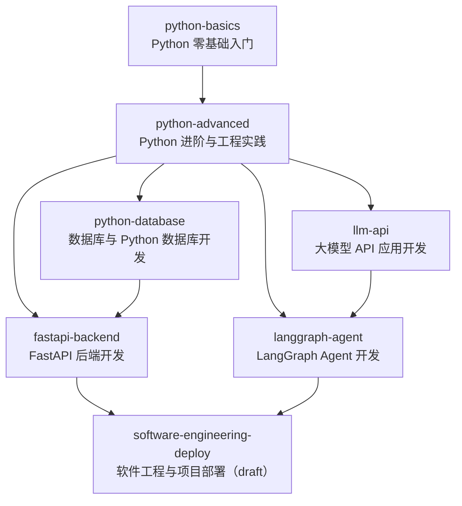

# 小码（Xiaoma）课程扩展：最终开发报告与独立验收

> 报告日期：2026-11-08
> 验收范围：课程扩展阶段 1～6（含阶段 6「课程体系接入学习闭环与 LangGraph Agent 集成」）
> 状态：**停在阶段 6**；本次只做独立验收与缺陷修复，未开始 V1.4 前端界面改造，未新增业务功能

## 报告说明与证据口径

- 本报告所有规模数字来自对开发库 `backend/data/xiaoma.db` 的**实际 SQL 查询**，以及 `app/seed/course_catalog_seed.py` 的**实际导入统计**；所有「通过」结论都对应本轮**实际执行过的命令输出**。
- 凡本轮未执行的验证（真实大模型端到端对话、Docker 部署、浏览器手工验收）一律在「尚未执行」中列出，**不计入通过项**。
- 「代码实现且自动化测试通过」与「生产运行库已有真实用户数据」严格区分，见第 14 节。
- 独立验收采用与阶段 6 开发不同的取证路径：重新读取代码、重新查询数据库、重新执行全量测试，不直接采信上一阶段的汇报数字。

---

# 第一部分：完整开发报告

## 1. 课程体系总览

课程数据采用七层结构，全部落在 SQLite 并由 Alembic 管理：

```
课程方向 (course_directions)
  └─ 课程 (courses)  ── 先修 (course_prerequisites) / 入学知识点 (course_knowledge_point_prerequisites)
       └─ 章节 (chapters)  ← 需求中的 CourseModule，本项目复用 chapters 表，module_id = chapter_id
            └─ 课时 (lessons)
                 └─ 知识点 (knowledge_points) ── 知识点先修 (knowledge_point_prerequisites)
                      ├─ 教学内容 (course_contents，15 个模块)
                      ├─ 练习 (exercises)
                      └─ 测验题 (question_bank)
```

| 维度 | 实测数量 | 说明 |
| --- | --- | --- |
| 课程方向 | 5 | `course_directions` 表 |
| 课程 | 7 | 6 门 `published`、1 门 `draft` |
| 章节 | 107 | `chapters` 表，无孤立行 |
| 课时 | 190 | `lessons` 表，无孤立行 |
| 知识点 | 194 | 194 个知识点全部有归属课时（`lesson_knowledge_points` 194 条，无一对多） |
| 教学内容 | 162 | 全部 `reviewed`，15 模块字段抽样 7 项零空值 |
| 练习 | 324 | 4 类题型 |
| 测验题 | 1085 | 全部 `approved` + `builtin` 校验，7 种题型 / 3 类认知层次 |
| 课程先修边 | 9 | 有向无环，无自环 |
| 知识点先修边 | 159 | 无自环 |
| 跨课程入学知识点 | 15 | `course_knowledge_point_prerequisites` |
| 数据库表 | 36 | 含 `alembic_version`，业务表 35 张 |
| Alembic 迁移 | 13 | 线性单头，当前 `7e6ec48dafbe (head)` |

学习闭环保持 V1.3 九段：**学习目标 → 入学诊断 → 学习计划 → 每日任务 → AI 教学 → 练习和测验 → 学习档案更新 → 动态计划调整 → 复习任务**。掌握度采用阶段 5 的 7 态模型（`not_started / learning / self_reported_completed / understood / applied / mastered / needs_review`），证据 append-only。

## 2. 五个课程方向

实测 `course_directions` 与 `course_direction_links`：

| # | 方向 code | 名称 | 关联课程 |
| --- | --- | --- | --- |
| 1 | `python-fundamentals` | Python 编程基础 | Python 零基础入门、Python 进阶与工程实践 |
| 2 | `python-engineering` | Python 工程与数据库 | Python 进阶与工程实践、数据库与 Python 数据库开发 |
| 3 | `python-backend` | Python 后端开发 | FastAPI 后端开发、软件工程与项目部署 |
| 4 | `ai-llm` | AI 大模型应用开发 | Python 大模型 API 应用开发、LangGraph Agent 开发 |
| 5 | `ai-agent` | AI Agent 与综合项目 | LangGraph Agent 开发、软件工程与项目部署 |

方向是**课程分类**，与能力等级 `recommended_level`（L0/L1/L2）分开管理；一门课可关联多个方向，主方向冗余在 `courses.direction`。

## 3. 七门核心课程

| # | code | 名称 | 主方向 | 难度 / 等级 | 预计分钟 | 发布状态 |
| --- | --- | --- | --- | --- | --- | --- |
| 1 | `python-basics` | Python 零基础入门 | python-fundamentals | beginner / L0 | 1510 | `published` |
| 2 | `python-advanced` | Python 进阶与工程实践 | python-fundamentals | intermediate / L1 | 410 | `published` |
| 3 | `python-database` | 数据库与 Python 数据库开发 | python-engineering | intermediate / L1 | 395 | `published` |
| 4 | `fastapi-backend` | FastAPI 后端开发 | python-backend | intermediate / L2 | 1265 | `published` |
| 5 | `llm-api` | Python 大模型 API 应用开发 | ai-llm | intermediate / L1 | 1215 | `published` |
| 6 | `langgraph-agent` | LangGraph Agent 开发 | ai-llm | advanced / L2 | 1835 | `published` |
| 7 | `software-engineering-deploy` | 软件工程与项目部署 | python-backend | intermediate / L2 | 985 | **`draft`（未完成）** |

发布门槛由 `CoursePublicationService.require_published()` 统一判定：`draft` / `archived` 课程返回 409，不能进入正式学习计划或每日任务。

## 4. 课程章节和课时数量

按课程实测（数据库 join 统计）：

| 课程 | 章节 | 课时 | 知识点 | 有正文课时 | 无正文课时 |
| --- | --- | --- | --- | --- | --- |
| `python-basics` | 20 | 29 | 60 | 29 | 0 |
| `python-advanced` | 10 | 12 | 13 | 12 | 0 |
| `python-database` | 9 | 11 | 11 | 11 | 0 |
| `fastapi-backend` | 16 | 31 | 31 | 31 | 0 |
| `llm-api` | 16 | 32 | 32 | 32 | 0 |
| `langgraph-agent` | 28 | 47 | 47 | 47 | 0 |
| `software-engineering-deploy` | 8 | 28 | 0 | 0 | **28** |
| **合计** | **107** | **190** | **194** | **162** | **28** |

**口径说明（独立验收核对）**：`tests/test_course_catalog.py` 断言 `EXPECTED_CHAPTERS = 93` / `EXPECTED_LESSONS = 175`，与开发库 107/190 不同。实测原因：目录种子 `CATALOG_COURSES` 只声明 87 章 161 课时（`python-basics` 的章节课时由 `course_seed.py` 维护，目录种子中为 6 章 14 课时）；测试库执行 `seed_courses + seed_catalog` 得到 93/175，而开发库在阶段 3 把 Python 基础教材重建为 20 章 29 课时（+14 章 / +15 课时），因此为 107/190。两者是**同一链路上不同阶段的快照，不是数据错误**，但阅读文档时容易误读，已列入第 15 节建议。

## 5. 教材内容完成情况

- 6 门已发布课程的 **162 个课时全部有正式教材正文**，覆盖率 162/162；`course_contents.status` 全部为 `reviewed`（尚未人工终审置 `published`）。
- 每份内容含 15 个模块：学习目标、为什么学、核心概念、通俗解释、语法介绍、示例代码、逐行解释、示例输出、常见错误、错误分析、入门练习、进阶练习、本节测验、学习总结、下一课建议。实测 `concept_explanation / example_code / summary / plain_explanation / why_learn / learning_objectives / common_mistakes` 七个字段空值均为 **0**。
- 教材中唯一命中 `TODO` 字样的位置是 `fastapi-backend-03-lesson-02` 示例代码里的枚举值 `todo = "todo"`（`TaskStatus`），属于真实教学代码，**不是占位符**；未发现 `待补充`、`TODO` 占位正文。
- 阶段 4D 已把「示例代码真实执行并与教材声明输出逐行比对」固化为测试（`test_example_output_matches_real_execution`），47 节零差异；本轮全量回归再次执行通过。
- **未完成**：`software-engineering-deploy` 的 28 个课时无正文、0 个知识点、0 练习、0 题，课程仍 `draft`。系统对此的处理是「草稿课程 409 拒绝进入正式计划」，不会把空课时伪装成教材；课时尚无正文时允许排期但明确标注「内容待补充」。

## 6. 练习和测验数量

| 类别 | 实测总量 | 分布 |
| --- | --- | --- |
| 练习 `exercises` | **324** | coding 205、short_answer 116、choice 2、project 1；空描述 0 |
| 测验题 `question_bank` | **1085** | 全部 `status=approved`、`validation_status=builtin` |
| 按题型 | 1085 | code_analysis 247、single_choice 217、short_answer 174、code_writing 166、true_false 156、multiple_choice 113、fill_blank 12 |
| 按认知层次 | 1085 | 基础理解 406、应用练习 349、代码阅读 330 |

按课程分布：`python-basics` 58 练习 / 287 题，`python-advanced` 24/72，`python-database` 22/66，`fastapi-backend` 62/186，`llm-api` 64/192，`langgraph-agent` 94/282，`software-engineering-deploy` 0/0。题目与知识点、练习与知识点均无孤立外键（实测 0 条）。

## 7. 课程依赖关系图

课程级先修共 **9 条边**（实测 `course_prerequisites`，无自环）：



| 课程 | 直接先修课程 |
| --- | --- |
| `python-advanced` | `python-basics` |
| `python-database` | `python-advanced` |
| `fastapi-backend` | `python-advanced`、`python-database` |
| `llm-api` | `python-advanced` |
| `langgraph-agent` | `python-advanced`、`llm-api` |
| `software-engineering-deploy` | `fastapi-backend`、`langgraph-agent` |

另有两张依赖表，语义不同、非重复结构：
- `knowledge_point_prerequisites`（**159 条**）：知识点 → 先修知识点；按课程分布为 python-basics 33、python-advanced 12、python-database 10、fastapi-backend 27、llm-api 31、langgraph-agent 46。
- `course_knowledge_point_prerequisites`（**15 条**）：课程 → 跨课程入学知识点，用于「补学提示」；未掌握的先修只提示补学，**不自动跳过**。
- `course_catalog.py` 提供依赖图接口（三色 DFS 环检测 + Kahn 拓扑排序 + 引用完整性）；学习计划生成时经 `CourseCatalogService.get_learning_path()` 读取。

## 8. 数据库和迁移文件

**当前库**：`backend/data/xiaoma.db`，36 张表，`alembic_version = 7e6ec48dafbe`。实测 `PRAGMA integrity_check = ok`、`PRAGMA foreign_key_check = []`、无孤立外键、无自环。

**迁移链（13 个文件，线性单头）**：

```
411f8d05cdb8 → 3ac5723b47d6 → a7577ec16a23 → 6497e0ceef46 → d0b5a8fe0785
→ e8b1c4d7a902 → 5a9439936da5 → b1c2d3e4f5a6 → c2d3e4f5a6b7
→ d3e4f5a6b7c8 → e4f5a6b7c8d9 → d8cfe871faa5 → 7e6ec48dafbe (head)
```

| 阶段 | 迁移 | 内容 |
| --- | --- | --- |
| 阶段 1 | `b1c2d3e4f5a6` | `lessons` / `course_contents` / `exercises` / `course_versions` / `lesson_knowledge_points` 5 表 |
| 阶段 2 | `c2d3e4f5a6b7` | 4 张方向与先修表 |
| 阶段 3 | `d3e4f5a6b7c8`、`e4f5a6b7c8d9` | 教材 8 列 + `status`、`question_bank.category` |
| 阶段 5 | `d8cfe871faa5` | `knowledge_mastery` / `mastery_evidence` / `exercise_attempts`，版本快照列与 `purpose` |
| **阶段 6** | **`7e6ec48dafbe`** | `plan_adjustment_proposals`、`review_requests` 两表；`learning_plan_versions.plan_context`；`daily_tasks` 三列 `course_id/chapter_id/lesson_id` 与外键；历史任务引用回填 |

阶段 6 迁移要点与风险处理：
- SQLite 不支持 `ALTER TABLE ADD CONSTRAINT`，三列与外键统一在 `with op.batch_alter_table("daily_tasks")` 中一次重建；`downgrade()` 同样用 batch 删除列。
- 三列设计为**可空**，仅为兼容升级前的历史任务；新生成的任务由 `DailyTaskService` 强制填齐四个标识。
- `_backfill_daily_task_refs()` 按 `knowledge_points → chapters → lesson_knowledge_points` 回填；确无归属课时则 `lesson_id` 保持 NULL，不猜测。
- 开发库曾出现「`alembic_version` 已 head 但 `plan_context` 列缺失」的历史漂移，已恢复 `data/backups/phase6-before.db` 并用 Alembic 完整重放；本轮实测 `alembic current / heads / check` 均为 `7e6ec48dafbe` 且零漂移。
- 本轮独立验收发现**迁移测试未覆盖阶段 6 两张新表与回填逻辑**，已补齐（见第二部分 P2）。

## 9. 新增 API

全项目实际注册 **77 条路由**（按 `@router.*` 精确解析，含多行装饰器）。按文件实测分布：`course_catalog.py` 10、`courses.py` 8、`learning_loop.py` 7、`mastery.py` 6、`daily_tasks.py` 5、`model_configs.py` 5、`plans.py` 5、`data.py` 4、`textbook.py` 4、`auth.py` / `conversations.py` / `diagnosis.py` / `knowledge_points.py` / `profile.py` / `quizzes.py` 各 3、`reviews.py` 2、`health.py` / `lessons.py` / `llm.py` 各 1。

课程扩展各阶段新增接口（只列本轮实测可归属的部分）：

| 阶段 | 新增接口 | 主要文件 |
| --- | --- | --- |
| 阶段 1 | 课时、练习、测验题、课程版本与发布状态等接口（与 V1.0 存量路由同在 `courses.py` / `lessons.py` / `knowledge_points.py`，本轮未逐条拆分计数） | `courses.py`、`lessons.py`、`knowledge_points.py` |
| 阶段 2 | **10 条**（实测） | `course_catalog.py`：方向、目录、依赖图、先修增删、学习路径、入学知识点 |
| 阶段 3 | **4 条**（实测） | `textbook.py`：教材大纲、10 项审计、课时教材、内容状态切换 |
| 阶段 5 | **9 条**（实测：`mastery.py` 6 + `diagnosis.py` 3） | 7 态、自述、练习、复习建议、跳级检查、诊断维度与跳级测验 |
| **阶段 6** | **8 条新增 + 1 条既有接口扩展** | 见下表 |

阶段 6 新增 / 修改：

| 方法 | 路径 | 作用 | Service |
| --- | --- | --- | --- |
| GET | `/api/v1/plan-adjustments/signals` | 盘点六类调整信号 | `PlanAdjustmentService.get_signals` → `PlanSignalService.collect` |
| POST | `/api/v1/plan-adjustments/proposals` | 只生成待确认提案 | `PlanAdjustmentService.propose` |
| GET | `/api/v1/plan-adjustments/proposals` | 提案列表（可按状态过滤） | `PlanAdjustmentService.list_proposals` |
| GET | `/api/v1/plan-adjustments/proposals/{id}` | 提案详情 | `PlanAdjustmentService.get_proposal` |
| POST | `/api/v1/plan-adjustments/proposals/{id}/confirm` | **用户确认后**才生效新版本 | `PlanAdjustmentService.confirm` |
| POST | `/api/v1/plan-adjustments/proposals/{id}/reject` | 只改提案状态 | `PlanAdjustmentService.reject` |
| POST | `/api/v1/review-requests` | 幂等复习申请 | `ReviewRequestService.request` |
| POST | `/api/v1/daily-tasks/today/generate` | 显式生成今日任务 | `DailyTaskService.generate_today_tasks` |
| GET | `/api/v1/daily-tasks/today?generate=false` | 首页只读查询（修改既有接口） | `DailyTaskService.get_today_tasks(generate=False)` |

所有路由只做参数校验与依赖注入，业务逻辑全在 Service；写操作无一处直接构造 SQL 或访问 Repository。

## 10. Service 层改动

`backend/app/services/` 共 31 个文件。阶段 6 新增 5 个、修改 4 个：

| 文件 | 类型 | 职责 |
| --- | --- | --- |
| `course_publication_service.py` | 新增 | 正式发布课程与真实课时唯一判定入口（`require_published` / `resolve_task_refs` / `_validate_lesson`）；409/422 拒绝草稿课程与不存在的课时 |
| `plan_context_service.py` | 新增 | 收集计划生成八类输入并写入 `plan_context` JSON 快照 |
| `plan_signal_service.py` | 新增（本轮修复） | 六类调整信号；阈值判定为纯函数 `consecutive_failures` / `is_downstream_mastery_signal`；区分实测达标与调用方声明 |
| `plan_adjustment_service.py` | 新增（本轮修复） | 提案 → 展示 → 用户确认 → 生效；`suggest_changes` 为纯函数 |
| `review_request_service.py` | 新增 | 按 user + kp + date 幂等写申请，返回真实错题复习任务，不改掌握状态 |
| `plan_service.py` | 修改 | `create_plan` / `adjust_plan` 先做发布校验，写入八因素快照，`_version_out` 输出 `plan_context` |
| `daily_task_service.py` | 修改 | 拆分为 `read_today_tasks` / `get_today_tasks(generate=)` / `generate_today_tasks`；三重幂等；固化四 ID；完成只写自述证据 |
| `teaching_prompt.py` | 修改 | 新增 3 条阶段 6 硬约束与 `build_course_material_section()` |
| `plan_adjustment_service.py` | 本轮修复 | 建议参数只由实测达标信号推导（详见 P1） |

配套 Repository：`phase6_repository.py` 新增；`course_repository.py`（预取课程层级）、`daily_task_repository.py`（预取四 ID 引用）、`mastery_repository.py`（`summary_map` / `count_evidence_by_source`）修改。模型：`models/phase6.py` 新增，`models/daily_task.py` / `models/learning_plan.py` 修改；Schema：`schemas/phase6.py` 新增，`schemas/daily_task.py` / `schemas/plan.py` 修改。

## 11. Agent 工具改动

`app/agent/tools.py` 重写为「声明式清单 + 工具实现」：

- **9 个必备工具**：`get_course`、`get_lesson`、`get_knowledge_point`、`get_user_learning_progress`、`get_today_tasks`、`submit_exercise`、`submit_quiz_result`、`request_review_task`、`propose_learning_plan_adjustment`。
- **7 个兼容工具**：`get_current_plan`、`get_progress`、`search_learning_resources`、`generate_quiz`、`get_quiz_attempts`、`get_mistakes`、`get_review_tasks`。
- **4 个写工具全部经 Service**：分别委托 `MasteryService.submit_exercise`、`QuizService.submit_attempt`、`ReviewRequestService.request`、`PlanAdjustmentService.propose`；`AgentToolbox` 不导入任何 Repository、不执行 SQL。
- **12 个禁止入口**在 `FORBIDDEN_TOOL_NAMES` 中列明（创建课程/课时/知识点、改发布状态、增删先修、跳先修、直接写掌握状态、确认计划/提案、调整计划），测试逐个断言不在清单且不是 `AgentToolbox` 方法。
- `Teaching Subgraph` 新增 `load_course_material` 节点：经 `AgentToolbox → CourseService` 读取知识点与课时正文 → `build_course_material_section()` 注入系统提示词；取不到内容明确标注「不要虚构课程内容」，工具 `failed` 抛 `AgentRunError`，不把失败包装成成功回答。
- `Planning Subgraph` 的「调整计划」分支改为只调用 `propose_learning_plan_adjustment()`，回复只展示待确认方案。
- 本轮修复前的真实缺陷（阶段 6 已修）：`propose_learning_plan_adjustment()` 算出参数白名单 `clean` 却未传入 `ProposalCreate`，导致用户参数被静默丢弃；已补 `**clean` 并有测试断言。

## 12. 测试结果

**本轮实际执行的命令与输出**（未执行的项目见第 14 节）：

| # | 命令 | 实际输出 | 阶段 |
| --- | --- | --- | --- |
| 1 | `pytest tests --basetemp=.pytest-tmp-accept -q` | **442 passed, 13 warnings in 455.83s** | 修复前基线 |
| 2 | `npm run lint` | eslint 无告警，退出 0 | 修复前 |
| 3 | `npx tsc --noEmit` | 无输出，退出 0 | 修复前 |
| 4 | `npm test`（Vitest） | **5 files / 18 passed**，Duration 32.35s | 修复前 |
| 5 | `npm run build` | Next.js 16.4.4 (Turbopack) 编译成功，**13 个静态页** | 修复前 |
| 6 | `alembic current` / `heads` / `check` | `7e6ec48dafbe (head)` / 单头 / `No new upgrade operations detected.` | 修复前后各一次 |
| 7 | 开发库 SQL 校验 | `integrity_check=ok`、`foreign_key_check=[]`、36 表、孤立外键 0 | 修复前 |
| 8 | 修复后 `pytest tests/test_phase6.py tests/test_alembic_migration.py tests/test_agent_api.py` | **35 passed, 13 warnings in 38.57s** | 修复后 |
| 9 | 修复后 `pytest tests --basetemp=.pytest-tmp-accept-final -q` | **445 passed, 13 warnings in 436.06s** | 修复后 |

- 445 = 基线 442 + 新增 `test_declared_only_signals_never_pretend_to_be_measured` 1 项 + `test_alembic_upgrade_creates_phase6_schema` / `test_alembic_backfills_historical_daily_task_refs` 2 项。
- 13 条 warning 全部来自第三方 `langsmith` 的 `asyncio.iscoroutinefunction` 弃用提示，与业务代码无关。
- 前端代码本轮**零改动**（修复只涉及后端 Service / 测试 / 文档），因此第 2～5 项结果仍为本轮实测值，未重复执行也不改判。
- 阶段 6 十项必测由 `backend/tests/test_phase6.py` 覆盖（现 17 项），逐项映射：今日任务引用真实课程、不重复生成、未掌握先修补学、已掌握不重复教学、诊断影响计划、测验影响复习、Agent 读课程库、写操作经 Service、调整需确认、原有闭环正常。

## 13. 原有 V1.3 功能回归情况

- 全量后端 **445 passed** 覆盖 V1.0～V1.3 既有测试文件：`test_course_api.py`、`test_plan_api.py`、`test_daily_task_api.py`、`test_quiz_api.py`、`test_seed.py`、`test_access_control.py`、`test_backup_service.py`、`test_agent_api.py`、`test_alembic_migration.py` 等，无一项被跳过或删除。
- 九段闭环端到端用例 `test_original_learning_loop_remains_intact`：设置学习目标 → 创建并确认计划 → 生成今日任务 → 开始/完成任务（断言只写 `self_reported_completed`）→ 提交测验 → 复习任务与掌握概览 → 提案确认后版本历史 `[1, 2]`，全部通过。
- 前端 18 项 Vitest 含 `AccessGate.test.tsx`（登录门禁）、`lib/api.test.ts`（401/SSE）、`conversations` / `quiz` 辅助逻辑，以及阶段 6 新增的 `DashboardClient.test.tsx` 4 项（先查后生成、已有任务不重复生成、四 ID 与掌握证据展示）。
- 兼容性策略未变：旧 `learning_profiles` 5 态取值与 CHECK 约束不改，由 `MasteryService._sync_legacy()` 投影；`GET /daily-tasks/today` 默认 `generate=true` 保持旧行为；`PlanService` 版本历史、已完成任务携带规则不变。
- 迁移可逆性：`test_alembic_downgrade_and_reupgrade` 实测降级到 base 后重新升级，全部表重建成功。

## 14. 尚未完成内容（明确标记，不计入完成）

| # | 项目 | 实际状态 | 影响 |
| --- | --- | --- | --- |
| 1 | 第 7 门课 `software-engineering-deploy` 教材 | **未完成**：8 章 28 课时、0 知识点 / 0 正文 / 0 练习 / 0 题，`draft` | 被发布门槛拒绝进入正式计划，不影响闭环 |
| 2 | 162 份教材内容人工终审 | **未完成**：状态全部 `reviewed`，未置 `published` | 阶段 6 口径把 `reviewed` 视为正式教材可用；最终发布前仍需产品负责人终审 |
| 3 | 阶段 6 新增业务表的真实用户运行数据 | **无**：开发库 `learning_plans` / `daily_tasks` / `plan_adjustment_proposals` / `review_requests` 等表均为 **0 行** | 功能由自动化测试在临时 SQLite 库中验证，生产库尚未产生真实学习记录 |
| 4 | 真实大模型端到端流式教学验收 | **本轮未执行** | 本轮使用 `ChatModelStub` / MockTransport 验证链路与提示词，未调用真实服务商 |
| 5 | Docker 部署与浏览器手工 UI 验收 | **本轮未执行** | 仅执行了代码级、API 级与构建级验证 |
| 6 | V1.4 前端界面改造 | **未开始**（按本次指令停止） | — |
| 7 | `declared_triggers` 的「实测/声明」区分 | 已用 `detail` 文本标注，**未新增结构化 `verified` 字段** | 前端目前靠文案提示，见第 15 节建议 |

## 15. 后续版本建议

1. **补完第 7 门课程**：按阶段 3～4D 的同一套 15 模块写入器建设 `software-engineering-deploy`，并完成后置终审，把 6 门课程 `reviewed` 内容统一置 `published`。
2. **统一掌握状态单一数据源**：当前 `knowledge_mastery`（7 态）与 `learning_profiles`（5 态投影）双表表达同一事实，靠 `MASTERY_TO_LEGACY` 同步维持一致（`mastered → mastered`，实测映射正确）。建议在 V1.4 把每日任务排期等剩余链路也切到 `MasteryService.mastered_kp_codes()`，再让旧表退化为只读兼容视图。
3. **统一目录与教材口径**：`CATALOG_COURSES` 声明 87 章 161 课时、`python-basics` 由 `course_seed.py` 维护，测试基线 93/175，开发库 107/190。建议在目录种子或文档中显式写出「教材重建后的开发库口径」，避免后来者误判为数据重复。
4. **信号来源结构化**：给 `PlanSignalOut` 增加 `verified: bool` 与 `source: measured|declared`，前端加来源徽标，替代当前依赖 `detail` 文本的方式。
5. **迁移回填防多值**：`_backfill_daily_task_refs()` 用 `LEFT JOIN lesson_knowledge_points`，若未来一个知识点归属多个课时会产生多行 UPDATE，最终值取决于返回顺序；当前实测「一对多」为 0，建议加 `GROUP BY` 或显式拒绝多值。
6. **真实运行验收**：在配置真实模型服务商后，按阶段 6 文档第八节的 6 步手工验收走一遍，并把开发库从「0 行运行数据」推进到真实学习记录。
7. **生产数据库演进**：`batch_alter_table` 是 SQLite 专用解法；若后续切换 PostgreSQL，需复核阶段 6 迁移的建表顺序与外键命名。

---

# 第二部分：独立验收

## A. 十项检查逐条结论

| # | 检查项 | 结论 | 取证方式 |
| --- | --- | --- | --- |
| 1 | 本阶段要求是否全部实现 | **通过** | 逐条比对阶段 6 指令；九段闭环、八因素、四 ID、9 工具、六信号、确认闸、十项必测均有代码与测试 |
| 2 | 是否存在只创建文件但没有实际实现的功能 | **通过** | 5 个新增 Service 均有完整方法体与调用方；`app/` 下仅 `core/crypto.py:77` 一处 `pass`，是 `os.chmod` 在 Windows 上失败时的显式降级（有注释），非空实现 |
| 3 | 是否存在假数据或硬编码数据冒充真实业务 | **发现 1 项，已修复** | `declared_triggers` 冒充实测信号（P1）；教材 `TODO` 是真实示例代码、测试断言的「什么是编程与 Python」是真实知识点名，均非假数据 |
| 4 | 是否存在重复代码和不合理的数据结构 | **发现 2 项观察，未改代码** | 双掌握数据源（P5）、目录/教材口径分叉（P6）；均有明确兼容理由且映射正确，属架构演进建议，非本阶段缺陷 |
| 5 | 是否影响原有 V1.3 功能 | **通过** | 修复后全量 445 passed；既有测试文件全部保留；旧闭环端到端用例通过；旧 `GET /today` 默认行为兼容 |
| 6 | 是否存在数据库迁移风险 | **发现覆盖缺口，已修复** | 迁移测试未覆盖阶段 6 两表与回填（P2）；补 2 项测试后，`alembic check` 零漂移、downgrade/re-upgrade 通过、回填实跑通过 |
| 7 | 是否存在 API 或 Service 层错误 | **通过（含 1 项已修复）** | 阶段 6 的 9 条路由（8 新增 + 1 扩展）全部委托 Service；确认闸正确；P1 属 Service 输出真实性问题，已修复并有测试 |
| 8 | 自动化测试是否实际执行 | **通过** | 第 12 节列出 9 组实际执行命令与原始输出；未执行项在第 14 节显式标注 |
| 9 | 测试是否覆盖核心业务流程 | **通过** | 十项必测 + 九段闭环端到端 + 迁移 upgrade/downgrade/回填 + 前端两步走组件测试 |
| 10 | 是否有未完成但被错误标记为完成的功能 | **发现信息不完整，已补正** | 上一阶段汇报未显式区分「代码测试通过」与「生产库无运行数据」，也未集中列出第 7 门课未完成；本报告第 14 节逐项明确标记 |

## B. 通过项

1. 课程体系规模与数据库实际数据一致（5 方向 / 7 课程 / 107 章 / 190 课时 / 194 知识点 / 162 正文 / 324 练习 / 1085 题）。
2. 正式发布门槛生效：6 门 `published`、1 门 `draft`；草稿课程 409、无归属课时 422 均有测试。
3. 今日任务四 ID 引用真实、生成幂等（先查后生成 + 唯一约束 + `IntegrityError` 回滚）、完成只写自述证据。
4. Agent 教学先经 `CourseService` 取课程库内容；16 个工具中 4 个写工具全经 Service；12 个禁止入口不存在。
5. 动态计划调整确认闸：`propose()` 只写提案，`confirm()` 才生成并生效新版本，`reject()` 只改状态。
6. 迁移链单头线性、零漂移、可逆、回填正确，开发库完整性检查全绿。
7. 全量后端 445 passed、前端 lint / `tsc --noEmit` / 18 Vitest / `next build` 全部实际执行通过。
8. V1.3 九段闭环端到端回归通过，既有测试无删减。

## C. 未通过项

**修复前存在 2 项未通过，均已修复并在修复后复验通过；截至报告出具，无遗留未通过项。**

| # | 修复前未通过项 | 复验结果 |
| --- | --- | --- |
| 1 | 检查项 3：`declared_triggers` 可在后端实测未达标时生成「检测到」信号，并据此自动追加 7 天缓冲 | 修复后新增测试断言「调用方声明 / 后端实测 0 项 / `changes == {}`」，定向 35 passed、全量 445 passed |
| 2 | 检查项 6：`test_alembic_migration.py` 的 `EXPECTED_TABLES` 缺阶段 6 两张表，且无任何测试验证 `plan_context` 列、三列引用与历史回填 | 补 2 项测试并实际跑通，含「无归属课时保持 NULL」反向断言 |

## D. 发现的问题、对应文件与修复建议

| 编号 | 问题 | 严重度 | 对应文件 | 修复建议 | 状态 |
| --- | --- | --- | --- | --- | --- |
| P1 | 六类触发信号宣称「全部基于真实数据」，实现却允许 `declared_triggers` 在实测未达标时混入 `signals`，`summary` 写成「检测到 N 项」，且 `suggest_changes()` 凭声明自动加 7 天缓冲 | 中 | `backend/app/services/plan_signal_service.py`、`plan_adjustment_service.py`、`schemas/phase6.py`、`api/v1/learning_loop.py`、`docs/课程扩展阶段6_学习闭环与Agent集成.md` | 实测/声明分流；声明项 `detail` 标注未实测；`summary` 分列统计；建议参数只取实测达标信号；同步文档口径 | **已修复** |
| P2 | 迁移测试未覆盖阶段 6 两张新表、八因素列、任务三列、复习申请唯一约束与历史任务回填 | 中 | `backend/tests/test_alembic_migration.py` | 补 `EXPECTED_TABLES` 与 2 项测试（结构断言 + 真实 upgrade 回填） | **已修复** |
| P3 | 工作区残留 10 个 `.pytest-tmp-*` 目录（约 1500 文件）、2 个无引用一次性脚本、旧 `.next` 构建缓存 2109 文件 | 低 | `backend/_new_fastapi_modules.txt`、`backend/_patch_catalog.py`、`backend/.pytest-tmp-*`、`frontend/.next-accept-old` | 清理可再生缓存与无引用脚本 | **已清理** |
| P4 | `PlanSignalOut` / API / 阶段 6 文档的「全部基于真实数据」措辞与实现不符 | 低 | `backend/app/schemas/phase6.py`、`api/v1/learning_loop.py`、`docs/课程扩展阶段6_学习闭环与Agent集成.md` | 改为「实测优先 + 声明线索明确标注」 | **已修复** |
| P5 | 掌握状态双数据源：`DailyTaskService` 读旧 `learning_profiles`，其余阶段 5/6 服务读 `knowledge_mastery` | 低（观察） | `backend/app/services/daily_task_service.py`、`mastery_service.py`、`models/mastery.py` | 实测 `MASTERY_TO_LEGACY` 仅 `mastered → mastered`，两源一致；建议 V1.4 统一到单一来源（第 15 节建议 2） | **未改代码，列为建议** |
| P6 | 目录种子口径（87/161，测试基线 93/175）与开发库教材口径（107/190）分叉 | 低（观察） | `backend/app/seed/course_catalog_seed.py`、`tests/test_course_catalog.py` | 差值 +14 章 / +15 课时已定位为 Python 基础教材重建，非错误；建议文档显式标注（第 15 节建议 3） | **未改代码，列为建议** |
| P7 | 开发库阶段 6 业务表全为 0 行，上一阶段汇报未显式区分「代码测试通过」与「生产库无运行数据」 | 信息 | 本报告第 14 节 | 明确标注并保留自动化验证证据 | **已补正** |
| P8 | 第 7 门课 `software-engineering-deploy` 未建教材 | 信息（未完成） | `backend/app/seed/course_catalog_seed.py`、开发库 | 文档已标 `draft` 且被发布门槛拦截；本报告第 14 节集中列出 | **明确标记未完成** |
| P9 | README 文档索引仍链接已被删除的 `docs/Xiaoma_PRD_V1.3.docx` 原件 | 低（非本阶段引入） | `README.md` | 改指向仍在的 `.md` 阅读镜像并注明原件已移除 | **已修复** |

## E. 修复记录

本轮实际改动的文件（均为修复或测试补强，无新增业务功能）：

| 文件 | 改动 |
| --- | --- |
| `backend/app/services/plan_signal_service.py` | 新增 `DECLARED_PREFIX`、`verified_count` / `verified_codes`、`record()` 分流；六类信号均有实测文案与声明文案；`summary` 分列统计；`SignalEvidence` 增加 `verified_signal_codes`；模块说明改写 |
| `backend/app/services/plan_adjustment_service.py` | `propose()` 的 `suggest_changes()` 改收 `evidence.verified_signal_codes` |
| `backend/app/schemas/phase6.py` | `PlanSignalOut` docstring 改为区分实测/声明 |
| `backend/app/api/v1/learning_loop.py` | `get_adjustment_signals` docstring 同步 |
| `backend/tests/test_phase6.py` | 新增 `test_declared_only_signals_never_pretend_to_be_measured` |
| `backend/tests/test_alembic_migration.py` | `EXPECTED_TABLES` 补两张表；新增 `test_alembic_upgrade_creates_phase6_schema` 与 `test_alembic_backfills_historical_daily_task_refs` |
| `docs/课程扩展阶段6_学习闭环与Agent集成.md` | 第五节增加「2026-11-08 独立验收修订」说明 |
| `README.md` | 修 PRD 失效链接；文档索引增加本报告 |
| `docs/开发进度与验收记录.md` | 追加本轮独立验收记录 |
| `.workbuddy/memory/2026-11-08.md` | 追加本轮验收与修复记录 |
| 工作区 | 删除无引用一次性脚本、可再生测试与构建缓存 |

## F. 实际测试结果（原始输出摘要）

```
修复前基线
$ cd backend && .venv/Scripts/python.exe -m pytest tests --basetemp=.pytest-tmp-accept -p no:cacheprovider -q
442 passed, 13 warnings in 455.83s (0:07:35)

$ cd frontend && npm run lint          → eslint 无输出，退出 0
$ cd frontend && npx tsc --noEmit     → 无输出，退出 0
$ cd frontend && npm test             → Test Files 5 passed (5) / Tests 18 passed (18)
$ cd frontend && npm run build        → Next.js 16.4.4 (Turbopack)，13/13 静态页，编译成功

$ cd backend && alembic current       → 7e6ec48dafbe (head)
$ cd backend && alembic heads         → 7e6ec48dafbe (head)   （单头）
$ cd backend && alembic check         → No new upgrade operations detected.
开发库 PRAGMA integrity_check = ok ; foreign_key_check = [] ; 36 张表

修复后定向复验
$ pytest tests/test_phase6.py tests/test_alembic_migration.py tests/test_agent_api.py
35 passed, 13 warnings in 38.57s

修复后全量复验
$ pytest tests --basetemp=.pytest-tmp-accept-final -p no:cacheprovider -q
445 passed, 13 warnings in 436.06s (0:07:16)

$ alembic check（修复后）              → No new upgrade operations detected.
```

**未执行、因此不标记为通过**：真实大模型服务商端到端流式教学、Docker Compose 部署验收、浏览器手工 UI 验收、第 7 门课教材建设与人工终审。

---

## 结论

阶段 6 的功能要求全部实现，十项必测与全量回归实际执行通过；独立验收发现 2 项真实缺陷（信号真实性、迁移测试覆盖）与 1 项信息不完整，均已修复并复验（442 → 445 passed）。另有 2 项架构观察与 1 项未完成课程已如实标记，未伪装为完成。

**状态：停在阶段 6**，等待后续指令；未启动 V1.4 前端界面改造，未添加新业务功能。
